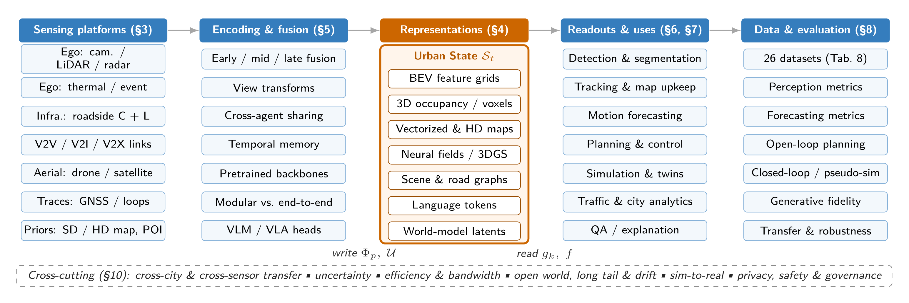

# Awesome Urban State Representation [](https://awesome.re)

[](https://arxiv.org/abs/2611.28129)
[](#citation)
[](CONTRIBUTING.md)

A curated, continuously updated list of papers, datasets, and benchmarks on **Urban State Representation (USR)**: shared representations of the city that any sensing platform (vehicles, roadside units, drones, satellites, mobility traces) can write to and any task (perception, prediction, planning, simulation, city analytics) can read from.

This repository accompanies the survey:

> **Urban State Representation for Autonomous Mobility: A Survey of Multimodal Perception, Architectures, Datasets, and Benchmarks**<br>
> Binay Kumar Singh, Niels Da Vitoria Lobo · University of Central Florida<br>
> *UrbanState Workshop at WACV 2027* · [Paper (arXiv)](https://arxiv.org/abs/2611.28129) · [Supplementary](supplementary/supplementary.pdf) · [BibTeX](#citation)

<p align="center">
  <a href="assets/usr_taxonomy.pdf"></a>
</p>
<p align="center"><em><b>Figure 1. Taxonomy of Urban State Representation (USR).</b> Heterogeneous platforms <b>write</b> to a shared, georeferenced, layered state S<sub>t</sub> through encoders and fusion operators. Downstream tasks and applications <b>read</b> from it, and datasets and protocols evaluate the whole chain. The bottom band lists challenges that cut across all stages.</em><br>
<sub>Vector versions: <a href="assets/usr_taxonomy.svg">SVG</a> · <a href="assets/usr_taxonomy.pdf">PDF</a> · LaTeX/TikZ source: <a href="assets/usr_taxonomy.tex">usr_taxonomy.tex</a></sub></p>


## Abstract

Cities are sensed by many platforms at once: on-board cameras, LiDAR and radar on autonomous vehicles, roadside units at intersections, drones and satellites overhead, and the GNSS traces of millions of trips. Yet most learned representations are built for one platform, one city, and one task. We survey this fragmented landscape through a single lens, the *Urban State Representation* (USR): a georeferenced, layered, time-varying, uncertainty-aware state that any sensing platform can write to and any downstream task can read from. We (i) formalize USR and five desiderata for it, and relate it to bird's-eye-view (BEV) features, occupancy, vectorized maps, neural fields and 3D Gaussians, scene graphs, road-network graphs, language tokens, and world-model latents; (ii) organize sensing platforms, cross-view (ground–aerial) matching, fusion operators, 3D geometric foundation models, end-to-end and vision-language-action models, and generative world models and data engines in one taxonomy that spans sensors to decisions; (iii) compile 26 urban datasets and simulators across ego, cooperative (V2X), aerial, trajectory, and language settings, with a metric glossary, a cross-benchmark results snapshot, a trend analysis, and a platform-coverage gap analysis; and (iv) review applications and propose, as an outlook, *USR-5*, a five-test protocol with explicit references and one aggregate score for measuring whether a state is shared, together with a research agenda of six open problems covering cross-city and cross-sensor transfer, uncertainty, efficiency, sim-to-real evaluation, and governance. This survey is an entry point for computer vision, autonomous driving, transportation, and urban computing researchers.

## Contents

- [Related Surveys](#related-surveys)
- [Representations](#representations)
- [Architectures](#architectures)
- [Datasets and Simulators](#datasets-and-simulators)
- [Benchmark Snapshot](#benchmark-snapshot)
- [USR-5 Benchmark Protocol](#usr-5-benchmark-protocol)
- [Supplementary Material and Code](#supplementary-material-and-code)
- [Citation](#citation)
- [Contributing](#contributing)

## Papers
### Related Surveys

- **Delving into the Devils of Bird's-Eye-View Perception: A Review, Evaluation and Recipe** — TPAMI 2024
- **A Survey on Occupancy Perception for Autonomous Driving: The Information Fusion Perspective** — Information Fusion 2025
- **Collaborative Perception in Autonomous Driving: Methods, Datasets, and Challenges** — IEEE ITS Magazine 2023
- **Vehicle-to-Everything Cooperative Perception for Autonomous Driving** — Proc. IEEE 2025
- **End-to-End Autonomous Driving: Challenges and Frontiers** — TPAMI 2024
- **A Survey on Multimodal Large Language Models for Autonomous Driving** — WACVW 2024
- **A Survey on 3D Gaussian Splatting** — arXiv 2024 [[arXiv](https://arxiv.org/abs/2401.03890)]
- **A Survey of World Models for Autonomous Driving** — arXiv 2025 [[arXiv](https://arxiv.org/abs/2501.11260)]
- **The Role of World Models in Shaping Autonomous Driving: A Comprehensive Survey** — Front. Comput. Sci. 2026
- **Urban Foundation Models: A Survey** — KDD 2024
- **Multi-Agent Embodied Autonomous Driving: From V2X Information Exchange to Shared World Models** — arXiv 2026 [[arXiv](https://arxiv.org/abs/2606.13840)]
- **Urban Computing: Concepts, Methodologies, and Applications** — ACM TIST 2014

### Representations


#### BEV Feature Grids

- **Lift, Splat, Shoot: Encoding Images from Arbitrary Camera Rigs by Implicitly Unprojecting to 3D** — ECCV 2020
- **BEVFormer: Learning Bird's-Eye-View Representation from Multi-Camera Images via Spatiotemporal Transformers** — ECCV 2022
- **BEVFusion: Multi-Task Multi-Sensor Fusion with Unified Bird's-Eye View Representation** — ICRA 2023

#### 3D Occupancy

- **Occ3D: A Large-Scale 3D Occupancy Prediction Benchmark for Autonomous Driving** — NeurIPS D&B 2023
- **SurroundOcc: Multi-Camera 3D Occupancy Prediction for Autonomous Driving** — ICCV 2023
- **GaussianFormer: Scene as Gaussians for Vision-Based 3D Semantic Occupancy Prediction** — ECCV 2024
- **FastOcc: Accelerating 3D Occupancy Prediction by Fusing the 2D Bird's-Eye View and Perspective View** — arXiv 2024 [[arXiv](https://arxiv.org/abs/2403.02710)]

#### Vectorized & HD Maps

- **MapTR: Structured Modeling and Learning for Online Vectorized HD Map Construction** — ICLR 2023
- **VAD: Vectorized Scene Representation for Efficient Autonomous Driving** — ICCV 2023
- **Trust, but Verify: Cross-Modality Fusion for HD Map Change Detection** — NeurIPS D&B 2021

#### Neural Fields & 3D Gaussians

- **NeRF: Representing Scenes as Neural Radiance Fields for View Synthesis** — ECCV 2020
- **Block-NeRF: Scalable Large Scene Neural View Synthesis** — CVPR 2022
- **3D Gaussian Splatting for Real-Time Radiance Field Rendering** — ACM TOG 2023
- **Street Gaussians: Modeling Dynamic Urban Scenes with Gaussian Splatting** — ECCV 2024
- **STORM: Spatio-Temporal Reconstruction Model for Large-Scale Outdoor Scenes** — ICLR 2025

#### Scene Graphs & Context

- **DriveLM: Driving with Graph Visual Question Answering** — ECCV 2024
- **Context-Aware Feature-Fusion for Co-occurring Object Detection in Autonomous Driving** — CVPR 2026 Precognition Workshop (non-archival) [[arXiv](https://arxiv.org/abs/2606.12628)]
- **Contextually Enhanced Unknown Aware Contrastive Learning-Based Co-Occurring Object Detection** — IEEE Access 2026, vol. 14, pp. 163030–163045 [[DOI](https://doi.org/10.1109/ACCESS.2026.3718368)]

#### Road-Network Graphs

- **Diffusion Convolutional Recurrent Neural Network: Data-Driven Traffic Forecasting** — ICLR 2018
- **Spatio-Temporal Graph Convolutional Networks: A Deep Learning Framework for Traffic Forecasting** — IJCAI 2018
- **Graph WaveNet for Deep Spatial-Temporal Graph Modeling** — IJCAI 2019

#### Language & Tokens

- **Learning Transferable Visual Models from Natural Language Supervision** — ICML 2021
- **DriveVLM: The Convergence of Autonomous Driving and Large Vision-Language Models** — CoRL 2024
- **EMMA: End-to-End Multimodal Model for Autonomous Driving** — TMLR 2025
- **AutoVLA: A Vision-Language-Action Model for End-to-End Autonomous Driving with Adaptive Reasoning and Reinforcement Fine-Tuning** — NeurIPS 2025

#### World-Model Latents

- **GAIA-1: A Generative World Model for Autonomous Driving** — arXiv 2023 [[arXiv](https://arxiv.org/abs/2309.17080)]
- **OccWorld: Learning a 3D Occupancy World Model for Autonomous Driving** — ECCV 2024

### Architectures


#### Detection & Sensor Fusion

- **Center-Based 3D Object Detection and Tracking** — CVPR 2021
- **FCOS3D: Fully Convolutional One-Stage Monocular 3D Object Detection** — ICCVW 2021
- **DETR3D: 3D Object Detection from Multi-View Images via 3D-to-2D Queries** — CoRL 2021
- **TransFusion: Robust LiDAR-Camera Fusion for 3D Object Detection with Transformers** — CVPR 2022
- **Exploring Object-Centric Temporal Modeling for Efficient Multi-View 3D Object Detection** — ICCV 2023
- **TransFuser: Imitation with Transformer-Based Sensor Fusion for Autonomous Driving** — TPAMI 2023

#### Cooperative (V2X) Perception

- **V2X-ViT: Vehicle-to-Everything Cooperative Perception with Vision Transformer** — ECCV 2022
- **Where2comm: Communication-Efficient Collaborative Perception via Spatial Confidence Maps** — NeurIPS 2022
- **End-to-End Autonomous Driving through V2X Cooperation** — AAAI 2025

#### 3D Geometric Foundation Models

- **DUSt3R: Geometric 3D Vision Made Easy** — CVPR 2024
- **Grounding Image Matching in 3D with MASt3R** — ECCV 2024
- **VGGT: Visual Geometry Grounded Transformer** — CVPR 2025
- **Depth Anything: Unleashing the Power of Large-Scale Unlabeled Data** — CVPR 2024

#### Vision Foundation Models

- **Segment Anything** — ICCV 2023
- **SatMAE: Pre-training Transformers for Temporal and Multi-Spectral Satellite Imagery** — NeurIPS 2022

#### End-to-End Planning

- **Planning-Oriented Autonomous Driving** — CVPR 2023
- **DiffusionDrive: Truncated Diffusion Model for End-to-End Autonomous Driving** — CVPR 2025
- **Is Ego Status All You Need for Open-Loop End-to-End Autonomous Driving?** — CVPR 2024

#### Motion Forecasting

- **Motion Transformer with Global Intention Localization and Local Movement Refinement** — NeurIPS 2022

#### Generative Data Engines & World Models

- **MagicDrive: Street View Generation with Diverse 3D Geometry Control** — ICLR 2024
- **DriveDreamer: Towards Real-World-Driven World Models for Autonomous Driving** — ECCV 2024
- **Vista: A Generalizable Driving World Model with High Fidelity and Versatile Controllability** — NeurIPS 2024
- **Cosmos World Foundation Model Platform for Physical AI** — arXiv 2025 [[arXiv](https://arxiv.org/abs/2501.03575)]
- **UniSim: A Neural Closed-Loop Sensor Simulator** — CVPR 2023

#### Cross-View (Ground–Aerial) Matching

- **Wide-Area Image Geolocalization with Aerial Reference Imagery** — ICCV 2015
- **Spatial-Aware Feature Aggregation for Image Based Cross-View Geo-Localization** — NeurIPS 2019
- **VIGOR: Cross-View Image Geo-Localization beyond One-to-One Retrieval** — CVPR 2021
- **TransGeo: Transformer Is All You Need for Cross-View Image Geo-Localization** — CVPR 2022
- **Beyond Cross-View Image Retrieval: Highly Accurate Vehicle Localization Using Satellite Image** — CVPR 2022

#### Traces & Map Matching

- **Hidden Markov Map Matching through Noise and Sparseness** — SIGSPATIAL 2009

#### Transfer & Uncertainty

- **Train in Germany, Test in the USA: Making 3D Object Detectors Generalize** — CVPR 2020
- **What Uncertainties Do We Need in Bayesian Deep Learning for Computer Vision?** — NeurIPS 2017

## Datasets and Simulators

The 26 datasets and simulators analysed in the survey, grouped by platform setting (also available as [`datasets.csv`](datasets.csv)). C: camera; L: LiDAR; R: radar; 4DR: 4D radar; G: GNSS; Lp: loop detectors; Q: language QA. Scale figures are approximate and follow each original paper.

| Setting | Dataset | Year | Modalities | Scale | Region | Primary tasks |
|---|---|---|---|---|---|---|
| Ego-centric | KITTI | 2012 | C, L, IMU | ~15k annotated frames | Karlsruhe (DE) | 3D detection, tracking, stereo, odometry |
| Ego-centric | Cityscapes | 2016 | C (stereo) | 5k fine + 20k coarse images | 50 cities (EU) | Semantic / instance segmentation |
| Ego-centric | nuScenes | 2020 | 6C, 1L, 5R | 1k scenes, 40k keyframes | Boston, Singapore | Detection, tracking, prediction, segmentation |
| Ego-centric | Waymo Open | 2020 | 5C, 5L | 1,150 scenes | 3 US cities | 2D/3D detection, tracking |
| Ego-centric | BDD100K | 2020 | C, G (dashcam) | 100k videos | NYC, SF Bay Area (US) | Detection, segmentation, lanes, drivable area, tracking |
| Ego-centric | WOMD | 2021 | Boxes, map | >100k 20 s scenes | 6 US cities | Interactive motion forecasting |
| Ego-centric | Argoverse 2 | 2021 | C, L, map | 1k sensor logs, 250k motion scenarios | 6 US cities | Detection, tracking, forecasting |
| Ego-centric | Occ3D | 2023 | C, L (derived) | nuScenes + Waymo | Multi-city | Semantic 3D occupancy |
| Conditions | ACDC | 2021 | C | 4,006 images | Switzerland | Segmentation in fog, night, rain, snow |
| Conditions | K-Radar | 2022 | 4DR, C, L | 35k frames | South Korea | All-weather 3D detection |
| Cooperative | OPV2V | 2022 | C, L (sim) | 11.5k frames, >70 scenes | CARLA | V2V cooperative detection |
| Cooperative | DAIR-V2X | 2022 | C, L | 71k frames | Beijing (CN) | V2I cooperative 3D detection |
| Cooperative | V2V4Real | 2023 | C, L | 20k LiDAR frames | Ohio (US) | Real V2V detection, tracking, sim2real |
| Cooperative | V2X-Seq | 2023 | C, L, map | 15k frames + 210k scenarios | Beijing (CN) | V2I tracking and forecasting |
| Cooperative | TUMTraf V2X | 2024 | C, L | 2k point clouds, 5k images | Munich (DE) | V2I detection and tracking |
| Aerial & satellite | highD | 2018 | C (drone) | 110k vehicles, 16.5 h | German highways | Naturalistic trajectories |
| Aerial & satellite | VisDrone | 2022 | C (drone) | 263 clips + 10k images | 14 cities (CN) | Aerial detection and tracking |
| Aerial & satellite | DeepGlobe | 2018 | C (satellite) | Road, building, land-cover tiles | Multi-country | Road extraction, land-cover segmentation |
| Aerial & satellite | MatrixCity | 2023 | C (sim) | ~519k aerial + street images | Synthetic city | City-scale neural rendering |
| Traces | GeoLife | 2010 | G | 17.6k trajectories, 182 users | Beijing (CN) | Mobility mining, mode inference |
| Traces | METR-LA | 2018 | Lp | 207 sensors, 4 months | Los Angeles (US) | Traffic-state forecasting |
| Planning & language | CARLA | 2017 | C, L, R (sim) | Simulator | Synthetic towns | Closed-loop driving |
| Planning & language | nuPlan | 2021 | C, L | ~1,500 h driving | 4 cities | Closed-loop planning |
| Planning & language | NAVSIM | 2024 | C, L | nuPlan-derived | 4 cities | Non-reactive pseudo-simulation (PDMS) |
| Planning & language | Bench2Drive | 2024 | C, L, R (sim) | 2M frames, 220 routes | CARLA | Closed-loop end-to-end, 44 scenarios |
| Planning & language | DriveLM | 2024 | C, Q | nuScenes + CARLA | Multi | Graph VQA, explainable planning |

## Benchmark Snapshot

Representative results as reported in the original works († = baseline re-evaluated in the cited work). The source of every number is listed in [`supplementary/data/results_provenance.csv`](supplementary/data/results_provenance.csv).

| Benchmark | Method | Input | Metric | Score |
|---|---|---|---|---|
| nuScenes test | CenterPoint | L | mAP / NDS | 60.3 / 67.3 |
| nuScenes test | BEVFormer | C | mAP / NDS | 48.1 / 56.9 |
| nuScenes test | StreamPETR (ViT-L) | C | mAP / NDS | 62.0 / 67.6 |
| nuScenes test | TransFusion | C+L | mAP / NDS | 68.9 / 71.7 |
| nuScenes test | BEVFusion | C+L | mAP / NDS | 70.2 / 72.9 |
| Occ3D-nuScenes (val) | BEVFormer† | C | mIoU | 26.88 |
| Occ3D-nuScenes (val) | FastOcc | C | mIoU | 39.21 |
| WOMD (test) | MTR | Tracks | mAP / minADE | 0.413 / 0.605 |
| DAIR-V2X | No collaboration† | L | AP@0.5 / 0.7 | 50.0 / 43.6 |
| DAIR-V2X | Where2comm | L | AP@0.5 / 0.7 | 63.7 / 48.9 |
| NAVSIM navtest | UniAD | C | PDMS | 83.4 |
| NAVSIM navtest | TransFuser | C+L | PDMS | 84.0 |
| NAVSIM navtest | DiffusionDrive | C+L | PDMS | 88.1 |
| Bench2Drive | VAD | C | Driving score | 42.35 |
| Bench2Drive | UniAD-Base | C | Driving score | 45.81 |

Pull requests adding newer results (with a link to the source) are welcome.

## USR-5 Benchmark Protocol

Single-task leaderboards cannot tell whether a representation is *shared*. **USR-5** compares a shared state with a reference on the same data, using five tests. It is proposed as an outlook: no system has yet been scored on all five tests, and only T1 can be filled from published numbers.

| Test | Question | Score $s_i$ | Reference $s_i^{\text{ref}}$ |
|---|---|---|---|
| **T1 Write** | Does adding a platform or sensor rig help? | Accuracy with the added platform (+ bytes sent) | Same model, ego platform only |
| **T2 Read** | Can one frozen state serve ≥3 tasks? | Mean head score relative to task-specific models ($s_2^{\text{ref}}=1$) | Task-specific model per head |
| **T3 Persistence** | Does prior state help on a revisit, including after map change? | Accuracy with prior state | Same model, empty prior state |
| **T4 Calibration** | Can its confidence be trusted? | 1 − ECE (+ unknown-object recall) | Single-platform model |
| **T5 Transfer** | Does it work in new cities, rigs, and conditions? | Accuracy on held-out data | Single-platform model, same training |

$$\text{USR-5} = \Big(\prod_{i=1}^{5} \min\big(s_i / s_i^{\text{ref}},\, 2\big)\Big)^{1/5}$$

Values above 1 mean sharing helps on balance. References should be the strongest published single-platform model or one matched in backbone and training budget. Report per-test scores alongside the aggregate; if a test is missing, report USR-*k* with the tests listed. Worked example (T1, DAIR-V2X): Where2comm reaches 63.7 AP@0.5 versus 50.0 without collaboration, a ratio of 1.27.

A reference implementation is in [`supplementary/code/usr5.py`](supplementary/code/usr5.py) (Python 3, standard library only):

```bash
python3 supplementary/code/usr5.py
```

**If you evaluate a method with USR-5, open a pull request and we will add it to a leaderboard here.**

## Supplementary Material and Code

| Path | Contents |
|---|---|
| [`supplementary/supplementary.pdf`](supplementary/supplementary.pdf) | Literature selection protocol, per-mark justification of the representation scorecard, dataset platform flags, source of every reported number, full USR-5 specification, first experiments for the open problems, historical timeline |
| [`supplementary/data/datasets_extended.csv`](supplementary/data/datasets_extended.csv) | The 26 datasets with platform flags and candidate USR-5 tests |
| [`supplementary/data/coverage_matrix.csv`](supplementary/data/coverage_matrix.csv) | Platform-coverage matrix with dataset names |
| [`supplementary/data/results_provenance.csv`](supplementary/data/results_provenance.csv) | Source paper of every reported number |
| [`supplementary/data/representation_rubric.csv`](supplementary/data/representation_rubric.csv) | Reason for each mark in the representation scorecard |
| [`supplementary/code/check_coverage.py`](supplementary/code/check_coverage.py) | Recomputes the coverage matrix from the dataset CSV |

## Citation

If you find this survey or repository useful, please cite:

```bibtex
@inproceedings{singh2027usr,
  title         = {Urban State Representation for Autonomous Mobility: A Survey of Multimodal Perception, Architectures, Datasets, and Benchmarks},
  author        = {Singh, Binay Kumar and Da Vitoria Lobo, Niels},
  booktitle     = {Proceedings of the IEEE/CVF Winter Conference on Applications of Computer Vision Workshops (WACVW)},
  year          = {2027},
  eprint        = {2611.28129},
  archivePrefix = {arXiv},
  primaryClass  = {cs.CV},
  doi           = {10.48550/arXiv.2611.28129},
  url           = {https://arxiv.org/abs/2611.28129}
}

```

## Contributing

Missing a paper, dataset, or result? Contributions are welcome via pull request or [issue](https://github.com/binayksingh/Awesome-Urban-State-Representation/issues). See [CONTRIBUTING.md](CONTRIBUTING.md). This list is updated monthly.

## License

The list content and data are released under [CC BY 4.0](https://creativecommons.org/licenses/by/4.0/); the code under the MIT License (see [LICENSE](LICENSE)). Figures are from the survey; please cite the paper when reusing them.
